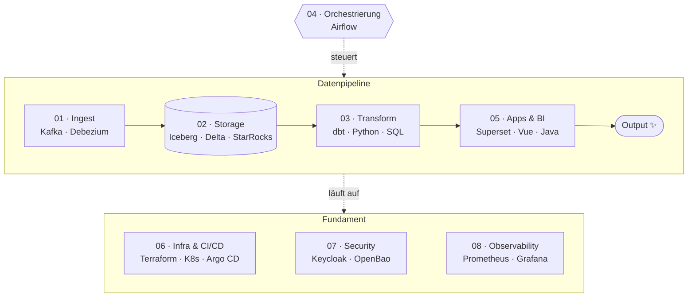

<div align="center">


<br/>

<a href="https://larsstimpel.de"></a>
<a href="https://www.linkedin.com/in/larsstimpel"></a>
<a href="mailto:l_stimpel@web.de"></a>


</div>

---

### `$ cat ueber-mich.yaml`

```yaml
name:      Lars Stimpel
rolle:     Data & DevOps Engineer Consultant @ RedArcs Consulting
standort:  Ingolstadt / München
fokus:     [Datenplattformen, CI/CD, Cloud]
mission:   Ich baue Datenpipelines und die Infrastruktur, auf der sie laufen.

definition_of_done:        # eine Pipeline ist erst fertig, wenn sie …
  - Tests hat
  - automatisch ausgerollt wird
  - überwacht ist, damit ich sehe, ob sie läuft

prinzipien:
  - Lösungen lieber einfach halten
  - Doku so schreiben, dass andere damit weiterarbeiten können
  - neue Tools an echten Problemen testen – manches auch einfach aus Neugier
```

### `$ dbt ls --select pipeline+` &nbsp;<sub>— mein Stack, Schicht für Schicht</sub>



<table>
<tr><td><code>01</code></td><td><b>Ingest</b><br/><sub>Daten dort abholen, wo sie entstehen – per CDC, Event-Stream oder API.</sub></td><td>   </td></tr>
<tr><td><code>02</code></td><td><b>Storage</b><br/><sub>Offene Tabellenformate: festes Schema, Time Travel, Rollback.</sub></td><td>      </td></tr>
<tr><td><code>03</code></td><td><b>Transform</b><br/><sub>Rohdaten → Tabellen, mit denen andere arbeiten können. Versioniert, getestet, mit Lineage.</sub></td><td>   </td></tr>
<tr><td><code>04</code></td><td><b>Orchestrierung</b><br/><sub>Richtige Reihenfolge, Retries – und eine Nachricht, wenn's nicht hilft.</sub></td><td></td></tr>
<tr><td><code>05</code></td><td><b>Apps & BI</b><br/><sub>Wo Daten bei den Menschen ankommen.</sub></td><td>    </td></tr>
<tr><td><code>06</code></td><td><b>Infra & CI/CD</b><br/><sub>Infrastructure as Code, GitOps statt Handarbeit auf dem Server.</sub></td><td>      </td></tr>
<tr><td><code>07</code></td><td><b>Security & Identity</b><br/><sub>Zentrale Anmeldung, Secrets gehören nicht ins Repo.</sub></td><td>  </td></tr>
<tr><td><code>08</code></td><td><b>Observability</b><br/><sub>Sehen, dass etwas hakt – bevor es jemand anderem auffällt.</sub></td><td>   </td></tr>
</table>

### `$ openssl verify -CAfile trust-store.pem lars.pem`

```diff
+ dbt Developer                              dbt Labs              ✓ gültig  05/2025 → 05/2027
+   Credential-ID: 143006453
! Certified Kubernetes Administrator (CKA)   The Linux Foundation  ⏳ in Arbeit
```

### `$ git log --graph --oneline --author="Lars Stimpel"`

```text
* 9fa1bf3 (HEAD -> main) Data & DevOps Engineer Consultant @ RedArcs Consulting   03/2025 – heute
|
* … ältere Commits: siehe LinkedIn
```

### `$ git log --graph --all` &nbsp;<sub>— mein Contribution-Graph, frisch verspeist</sub>

<picture>
  <source media="(prefers-color-scheme: dark)" srcset="https://raw.githubusercontent.com/larsskrachen/larsskrachen/output/snake-dark.svg"/>
  <source media="(prefers-color-scheme: light)" srcset="https://raw.githubusercontent.com/larsskrachen/larsskrachen/output/snake.svg"/>
  
</picture>

### `$ ls ./öffentlich`

<p align="center">
  <a href="https://github.com/larsskrachen/find-in-files">
    
  </a>
  <a href="https://github.com/larsskrachen/zsh_history">
    
  </a>
</p>

<details>
<summary><b>🥚 <code>$ sudo make me a sandwich</code></b></summary>

<br/>

```text
[sudo] Passwort für lars: ********
Okay. 🥪  (Deployment via Argo CD, Rollback jederzeit möglich.)
```

Wer einen 3D-Flug durch eine Datenpipeline sehen will: **[larsstimpel.de](https://larsstimpel.de)** 🚀

</details>

### `$ ./kontakt.sh`

Du hast eine Frage zu einem Projekt oder willst dich einfach fachlich austauschen?
Schreib mir eine [Mail](mailto:l_stimpel@web.de) oder eine Nachricht auf [LinkedIn](https://www.linkedin.com/in/larsstimpel).

<div align="center">

</div>
