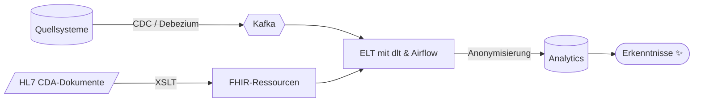

<div align="center">



<br/>

<a href="https://github.com/larsskrachen?tab=repositories"></a>
<a href="https://github.com/larsskrachen?tab=followers"></a>


</div>

---

### `$ cat ueber-mich.md`

```yaml
name:      Lars
rolle:     Developer mit Hang zu Daten, Pipelines und sauberer Infrastruktur
fokus:
  - Data Engineering        # ETL/ELT, Change Data Capture, Orchestrierung
  - Health-IT               # HL7 CDA ➜ FHIR, XSLT-Transformationen, Interoperabilität
  - Privacy by Design       # Anonymisierung & verantwortungsvolle Datennutzung
  - Homelab                 # Infrastructure as Code, Self-Hosting, Tüfteln
gerade:    lerne ständig Neues – und schreibe es am liebsten gleich in Code
motto:     "Wenn du es zweimal machst, automatisiere es."
```

### `$ ls ./werkzeugkasten`

<p align="center">
  
  <br/>
  
</p>

<p align="center">
  
  
  
  
  
  
  
</p>

### `$ cat pipeline.mmd` &nbsp;<sub>— so denke ich über Daten</sub>



### `$ git log --graph --author=lars`

<picture>
  <source media="(prefers-color-scheme: dark)" srcset="https://raw.githubusercontent.com/larsskrachen/larsskrachen/output/snake-dark.svg"/>
  <source media="(prefers-color-scheme: light)" srcset="https://raw.githubusercontent.com/larsskrachen/larsskrachen/output/snake.svg"/>
  
</picture>

### `$ ls ./öffentlich`

<p align="center">
  <a href="https://github.com/larsskrachen/find-in-files">
    
  </a>
  <a href="https://github.com/larsskrachen/zsh_history">
    
  </a>
</p>

<details>
<summary><b>🥚 <code>$ sudo make me a sandwich</code></b></summary>

<br/>

```text
[sudo] Passwort für lars: ********
Okay. 🥪
```

Fun Fact: Dieses Profil ist komplett aus selbstgebauten SVG-Animationen und einer GitHub Action zusammengesetzt – schau gern in den [Quellcode](https://github.com/larsskrachen/larsskrachen).

</details>

<div align="center">

</div>
